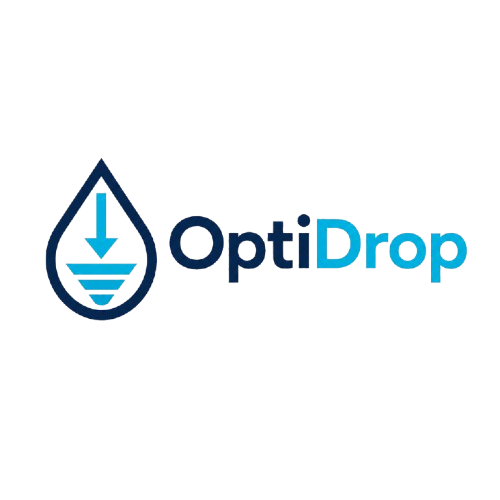

# 💧 OptiDrop - The Ultimate Free Document Toolkit

OptiDrop is a **100% browser-based document processing toolkit** designed to help users quickly format, compress, and edit files for strict government portals, university exams, and visa applications. 

The best part? **Zero server uploads.** Everything runs locally in your browser, ensuring 100% privacy for your sensitive documents like passports, IDs, and signatures.

 *(Note: Ensure this image is uploaded to your repo)*

---

## 🚀 Features (The 8 Tools)

OptiDrop includes 8 powerful tools designed to solve the most common document formatting headaches:

1. 🎯 **Image Compressor:** Compress photos to exact KB limits (e.g., exactly under 50KB or 20KB).
2. 📄 **Images to PDF Merger:** Combine multiple JPG/PNG files into a single PDF document.
3. 📱 **HEIC to JPG Converter:** Instantly convert iPhone HEIC photos to JPG format.
4. ✂️ **PDF to JPG Extractor:** Extract each page of a PDF as a separate, high-quality JPG image.
5. 🖼️ **300 DPI Photo Resizer:** Crop and resize photos to exact passport dimensions (India, US, UK, Schengen, etc.) and force 300 DPI print-ready output.
6. ✍️ **Signature Scanner:** Turn messy, phone-taken photos of signatures into clean, B&W, high-contrast images under 20KB.
7. 📅 **Name & Date Stamper:** Overlay custom text (Name and Date) directly onto photos for Indian exam requirements (NEET, JEE, UPSC).
8. 🔍 **Image Text Extractor (OCR):** Extract text from screenshots, forms, or notes directly in the browser and copy to clipboard.

---

## 🔐 100% Client-Side Privacy

OptiDrop processes everything inside your web browser. 
- **No server uploads**
- **No data storage**
- **No tracking**
- **Works offline** (once the page and CDNs are loaded)

---

## 🛠 Tech Stack

OptiDrop is built to be lightweight, fast, and highly accessible without complex backend infrastructure.

* **Frontend:** HTML5, Vanilla JavaScript, Tailwind CSS
* **Core APIs:** HTML5 Canvas, Web Workers
* **External Libraries (via CDN):**
  * `heic2any`: Client-side HEIC decoding
  * `pdf.js`: PDF rendering and extraction
  * `tesseract.js`: Optical Character Recognition (OCR)
  * `jsPDF`: PDF generation
  * `JSZip`: Batch file zipping and downloading

---

## 💻 Getting Started (Local Development)

Since OptiDrop has no backend, setting it up locally is incredibly simple.

1. **Clone the repository:**
   ```bash
   git clone https://github.com/YOUR-USERNAME/optidrop.git
   cd optidrop
